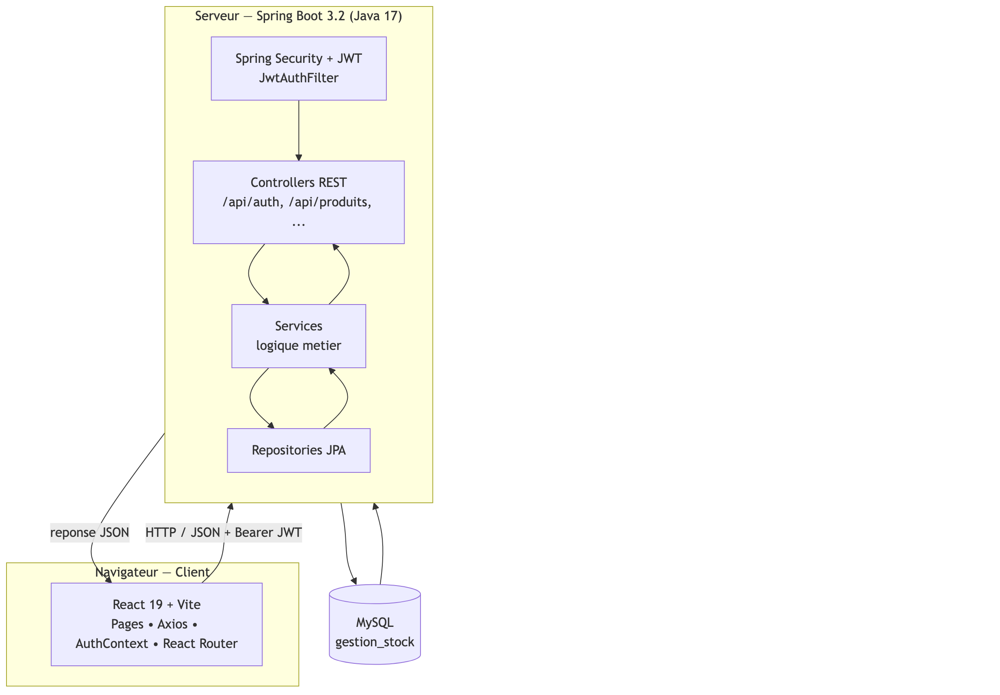
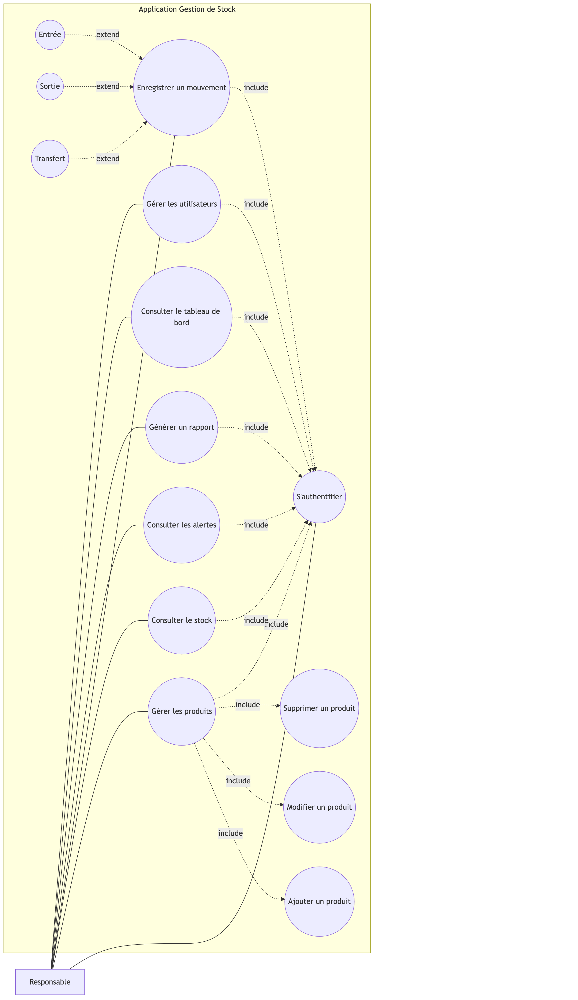
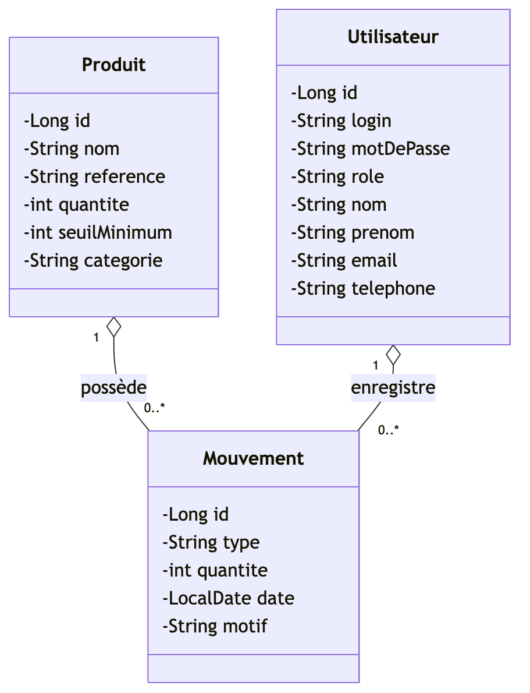
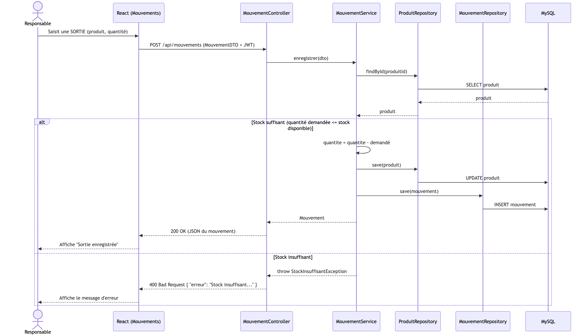
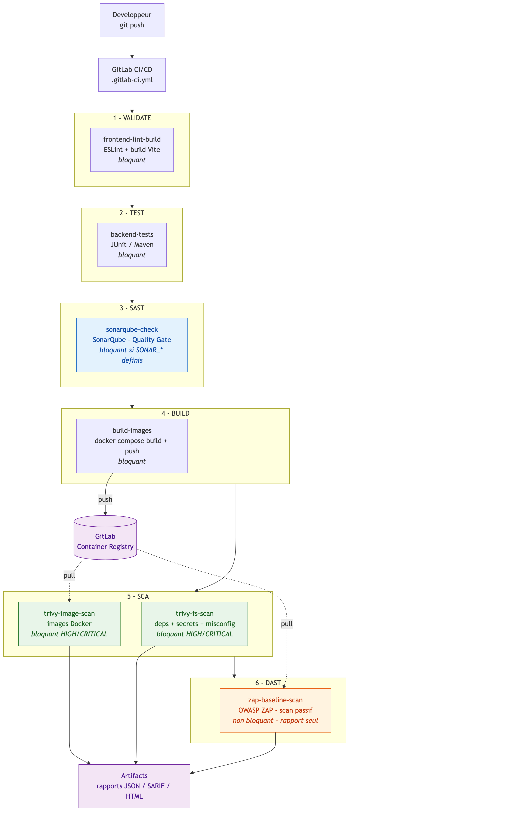

# 📦 StockIQ — Système de Gestion de Stock

> Application web **full-stack** de gestion d'inventaire, sécurisée par **JWT**, conteneurisée avec **Docker** et livrée par un pipeline **DevSecOps** complet (SAST · SCA · DAST).


---

## 📑 Sommaire

1. [Présentation](#-présentation)
2. [Objectifs](#-objectifs)
3. [Fonctionnalités](#-fonctionnalités)
4. [Technologies](#-technologies)
5. [Architecture](#-architecture)
6. [Prérequis](#-prérequis)
7. [Installation et exécution](#-installation-et-exécution)
8. [Tests](#-tests)
9. [Pipeline DevSecOps](#-pipeline-devsecops)
10. [Résultats](#-résultats)
11. [Structure du projet](#-structure-du-projet)
12. [Documentation](#-documentation)
13. [Auteur](#-auteur)

---

## 🎯 Présentation

**StockIQ** permet à une entreprise de piloter son inventaire de bout en bout : catalogue de produits, entrées, sorties et transferts de stock, alertes de rupture, tableau de bord analytique, rapports sur une période et gestion des comptes administrateurs.

Le projet a été réalisé dans le cadre du module **Frameworks** (4ᵉ année, Génie Informatique). Il va au-delà d'une simple application CRUD : sécurité, tests automatisés, conteneurisation et une chaîne CI/CD orientée sécurité.

## 🧭 Objectifs

- Concevoir une **API REST** en couches, propre et documentée (Swagger / OpenAPI).
- Construire une **interface web réactive** et moderne avec React.
- Sécuriser l'application : **authentification JWT stateless**, mots de passe hachés avec **BCrypt**, aucun secret dans le code.
- Garantir la qualité avec des **tests unitaires, d'intégration et end-to-end**.
- Industrialiser la livraison avec **Docker** et un pipeline **GitLab CI/CD DevSecOps**.

## ✨ Fonctionnalités

| Module | Description |
|---|---|
| 🔐 **Authentification** | Connexion par JWT, routes protégées côté client et serveur. |
| 📦 **Produits** | CRUD complet : référence unique, catégorie, quantité, seuil minimum. |
| 🔄 **Mouvements** | Entrées, sorties et transferts, avec contrôle du stock disponible (pas de stock négatif). |
| 🔔 **Alertes** | Détection automatique des produits sous leur seuil minimum. |
| 📊 **Tableau de bord** | Indicateurs clés et graphiques interactifs (Recharts). |
| 🧾 **Rapports** | Historique des mouvements filtré entre deux dates. |
| 👥 **Administration** | Gestion des comptes (création, modification, suppression, changement de mot de passe). |
| 👤 **Profil** | Consultation du compte connecté. |
| 📘 **API documentée** | Swagger UI interactif pour tester tous les endpoints. |

## 🛠 Technologies

| Couche | Technologies |
|---|---|
| **Backend** | Java 17, Spring Boot 3.2 (Web, Data JPA, Security, Validation, Actuator), Hibernate, JJWT 0.11, Lombok, springdoc-openapi |
| **Frontend** | React 19, Vite 8, React Router 7, Axios, Recharts |
| **Base de données** | MySQL 8 (production), H2 en mémoire (tests) |
| **Tests** | JUnit 5, Mockito, Spring Security Test, MockMvc, Playwright (E2E) |
| **DevOps** | Docker, Docker Compose, nginx, GitLab CI/CD |
| **Sécurité (DevSecOps)** | SonarQube (SAST), Trivy (SCA et scan d'images), OWASP ZAP (DAST) |

## 🏗 Architecture

```
┌──────────────┐     /api (proxy nginx)    ┌────────────────┐      JDBC       ┌──────────┐
│   Frontend   │ ────────────────────────► │    Backend     │ ──────────────► │  MySQL   │
│ React + Vite │ ◄──────────────────────── │  Spring Boot   │ ◄────────────── │   8.0    │
│ (nginx :80)  │        JSON + JWT         │    (:8080)     │                 └──────────┘
└──────────────┘                           └────────────────┘
```

- **Backend** (`demo/`) : architecture en couches `controller → service → repository → entity`, complétée par `dto`, `security` (filtre JWT), `config` et `exception` (gestion globale des erreurs).
- **Frontend** (`frontend/`) : SPA React, un intercepteur Axios injecte le JWT, un contexte d'authentification protège les routes privées.
- **Déploiement** : avec Docker, nginx sert le frontend **et** redirige `/api` vers le backend (même origine, donc pas de problème de CORS).

<details>
<summary>📐 Diagrammes UML (cliquer pour afficher)</summary>

| Architecture | Cas d'utilisation |
|---|---|
|  |  |

| Diagramme de classes | Séquence : sortie de stock |
|---|---|
|  |  |

Les sources Mermaid sont dans [`docs/uml/`](docs/uml/).
</details>

## ✅ Prérequis

| Outil | Version | Usage |
|---|---|---|
| **Docker + Docker Compose** | récent | Démarrage recommandé (tout-en-un) |
| **JDK** | **17** | Backend hors Docker |
| **Node.js** | 22+ | Frontend hors Docker |
| **MySQL** | 8.x | Base de données hors Docker |

## 🚀 Installation et exécution

### 1. Cloner le dépôt

```bash
git clone https://github.com/<votre-utilisateur>/stockiq-gestion-de-stock.git
cd stockiq-gestion-de-stock
```

### 2. Option A — Docker (recommandé)

Une seule commande démarre MySQL, le backend et le frontend, et crée un compte administrateur :

```bash
cp .env.example .env        # puis remplacez les valeurs « changeme » dans .env
docker compose up --build
```

- Application : **http://localhost**
- Connexion : `admin` / *mot de passe défini dans `DEFAULT_ADMIN_PASSWORD`*

Pour tout arrêter et supprimer les données :

```bash
docker compose down -v
```

### 3. Option B — Exécution manuelle (développement)

**Backend** (port 8080, MySQL local requis) :

```bash
cd demo
export DB_URL="jdbc:mysql://localhost:3306/gestion_stock?createDatabaseIfNotExist=true"
export DB_USERNAME=root
export DB_PASSWORD=<votre_mot_de_passe_mysql>
export JWT_SECRET=<une_chaine_aleatoire_de_32_caracteres_minimum>
export DEFAULT_ADMIN_ENABLED=true
export DEFAULT_ADMIN_PASSWORD=<mot_de_passe_admin>
./mvnw spring-boot:run
```

**Frontend** (port 5173, dans un autre terminal) :

```bash
cd frontend
cp .env.example .env
npm install
npm run dev
```

- Application : **http://localhost:5173**
- Swagger UI : **http://localhost:8080/swagger-ui.html**

> ℹ️ Toutes les variables de configuration sont décrites dans [`.env.example`](.env.example) et dans le [guide d'utilisation](docs/GUIDE-UTILISATION.md).

## 🧪 Tests

```bash
# Backend : tests unitaires et d'intégration (H2 en mémoire, aucune base requise)
cd demo && ./mvnw test

# Frontend : analyse statique et build de production
cd frontend && npm run lint && npm run build

# Frontend : tests end-to-end Playwright
cd frontend && npx playwright install && npm run test:e2e
```

| Suite | Type | Tests |
|---|---|---|
| `ProduitServiceTest` | Unitaire (Mockito) | 8 |
| `MouvementServiceTest` | Unitaire (Mockito) | 9 |
| `ProduitControllerTest` | Intégration (MockMvc + Security) | 7 |
| `AuthControllerTest` | Intégration (MockMvc + Security) | 3 |
| `DemoApplicationTests` | Chargement du contexte Spring | 1 |
| `e2e/*.spec.js` | End-to-end (Playwright) | 5 |

## 🔐 Pipeline DevSecOps

Le fichier [`.gitlab-ci.yml`](.gitlab-ci.yml) automatise toute la chaîne qualité et sécurité :

```
validate ──► test ──► sast ──► build ──► sca ──► dast
 lint +      JUnit    Sonar    images   Trivy    OWASP
 build       Mockito  Qube     Docker   fs+image ZAP
```

| Étape | Outil | Rôle |
|---|---|---|
| **validate** | ESLint, Vite | Lint et build du frontend |
| **test** | Maven, JUnit 5 | Tests backend |
| **sast** | SonarQube | Analyse statique du code, avec quality gate bloquante |
| **build** | Docker | Construction et publication des images backend et frontend |
| **sca** | Trivy | Vulnérabilités des dépendances et des images Docker |
| **dast** | OWASP ZAP | Scan dynamique de l'application déployée |



## 📈 Résultats

- ✅ **28 / 28 tests backend réussis** (0 échec, 0 erreur) sur les couches service, contrôleur et sécurité.
- ✅ **Lint ESLint sans erreur** et **build de production Vite réussi**.
- ✅ **Application conteneurisée** : démarrage complet en une commande avec `docker compose up`.
- ✅ **Sécurité intégrée dès la conception** : JWT stateless, BCrypt, configuration externalisée par variables d'environnement, compte admin par défaut désactivé.
- ✅ **Pipeline DevSecOps en 6 étapes** combinant SAST, SCA et DAST.
- ✅ **Documentation complète** : guide d'utilisation, API Swagger, diagrammes UML, rapport et présentation du projet.

## 🗂 Structure du projet

```
.
├── demo/                     # Backend Spring Boot
│   ├── src/main/java/com/gestionstock/demo/
│   │   ├── controller/       # Endpoints REST (/api/...)
│   │   ├── service/          # Logique métier
│   │   ├── repository/       # Accès aux données (Spring Data JPA)
│   │   ├── entity/           # Entités JPA (Produit, Mouvement, Utilisateur)
│   │   ├── dto/              # Objets de transfert
│   │   ├── security/         # JWT, filtre, configuration Spring Security
│   │   ├── config/           # Swagger, initialisation des données
│   │   └── exception/        # Gestion globale des erreurs
│   ├── src/test/             # Tests JUnit / Mockito / MockMvc
│   └── Dockerfile
├── frontend/                 # Frontend React + Vite
│   ├── src/pages/            # Pages (Dashboard, Produits, Mouvements, ...)
│   ├── src/components/       # Navbar, PrivateRoute
│   ├── src/context/          # Contexte d'authentification
│   ├── src/api/              # Client Axios (JWT)
│   ├── e2e/                  # Tests Playwright
│   ├── nginx.conf
│   └── Dockerfile
├── docs/                     # Guide, UML, rapport, présentation
├── docker-compose.yml        # Stack MySQL + backend + frontend
├── .gitlab-ci.yml            # Pipeline DevSecOps
├── sonar-project.properties  # Configuration SonarQube
└── .env.example              # Modèle de variables d'environnement
```

## 📚 Documentation

- 📘 [Guide d'utilisation et de configuration](docs/GUIDE-UTILISATION.md) : installation, configuration, référence API, dépannage
- 📐 [Diagrammes UML](docs/uml/)
- 📄 Rapport et présentation du projet : dossier [`docs/`](docs/)
- 🔎 API interactive : `http://localhost:8080/swagger-ui.html` (backend démarré)

## 👩‍💻 Auteur

**Fatim Mifrah** · 4ᵉ année de Génie Informatique · à la recherche d'un **stage de fin d'études (PFE)**.

- 📧 mifrah.fz1@gmail.com
- 💼 LinkedIn : *à compléter*
